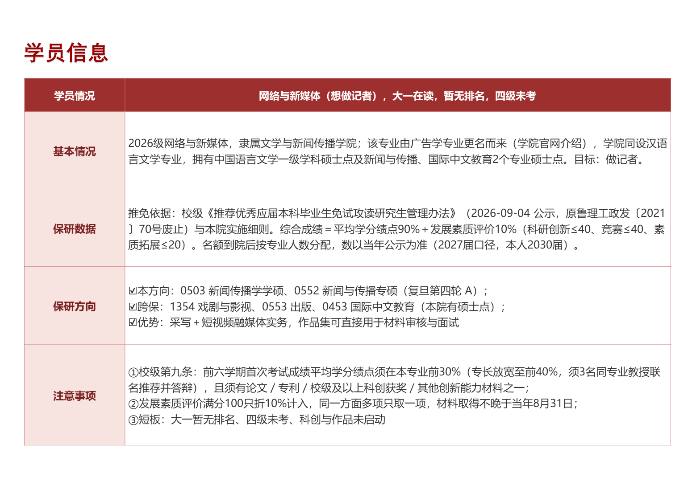
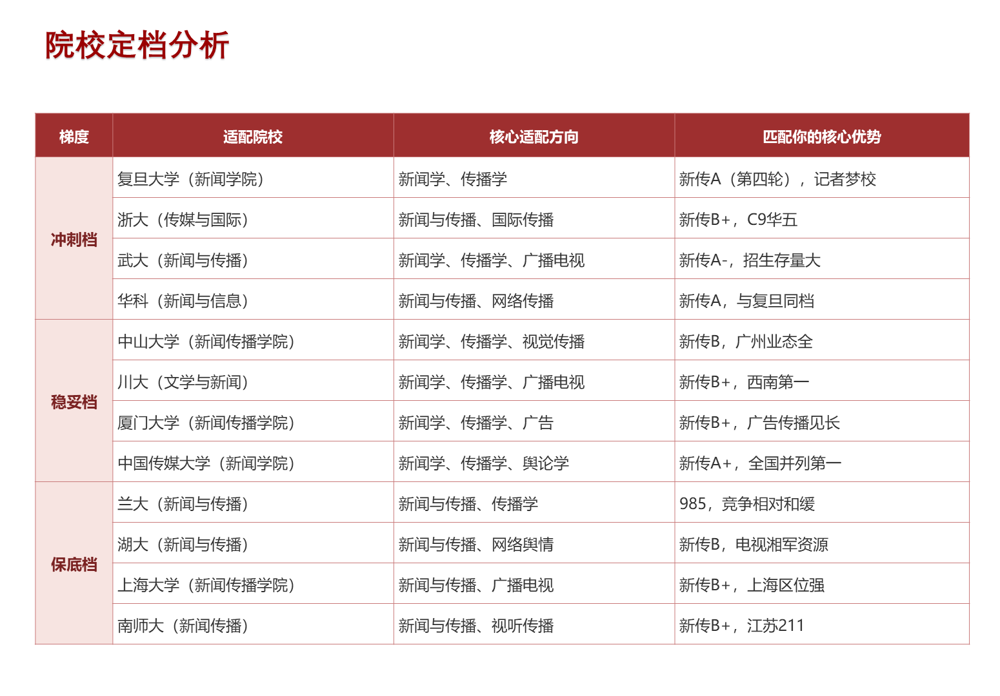
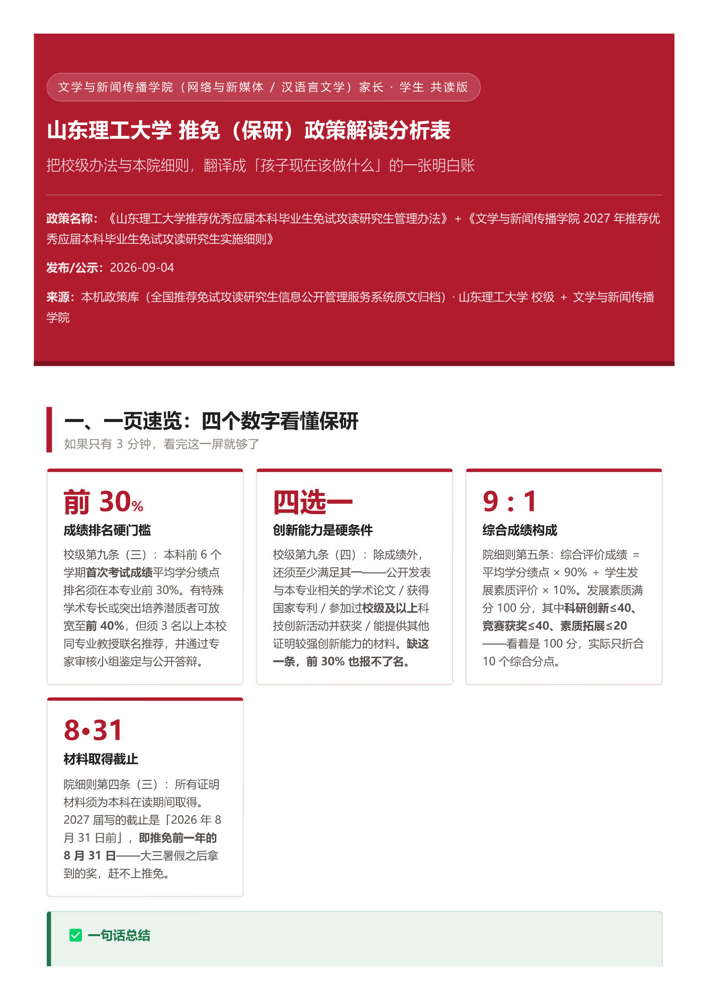

# 保研 AI Skills · 两个原创技能包

给**保研规划师**用的 AI Agent 技能，不是通用写作模板。

一个管**产出**：学员背景 → 一键出 PPT 规划表；院校政策原文 → 家长学生看得懂的解读 HTML。
一个管**成交**：本机微信聊天记录 → 每天排出该跟谁、卡在哪、下一句说什么。

两个技能都按 [Agent Skills](https://docs.claude.com/en/docs/claude-code/skills) 的 `SKILL.md` 规范写成，**WorkBuddy / Claude Code / 任何读 SKILL.md 的 agent 都能直接用**。

| 技能 | 干什么 | 典型触发 |
| --- | --- | --- |
| [`baoyan-planner-tables`](baoyan-planner-tables/) | 学员背景 → 原生 PPT 表格规划表（学员信息 + 冲稳保定档）；政策文件 → 11 模块政策解读 HTML | 「给学员出个保研规划表」「根据这份推免政策出个解读」 |
| [`baoyan-deal-chat`](baoyan-deal-chat/) | 读本机微信聊天 → 每日聊单作战图（在跟线索 / 今日必做 Top 8 / 存量老客户 / 渠道剔除）、异议话术、成交复盘 | 「今天该先跟谁」「客户说太贵了怎么回」 |

---

## 一、baoyan-planner-tables（保研规划师工作台）

**输入**：学员背景（院校 / 专业 / 年级 / 绩点 / 英语 / 竞赛）。
**输出**：两张表以**原生 PPT 表格**写进 PPT（不是截图、不是图片），附数据源 JSON。

- 表 1 学员信息表（2 列 5 行：基本情况 / 保研数据 / 保研方向 / 注意事项）
- 表 2 冲稳保定档表（冲 / 稳 / 保各 4 所，985·211·双一流硬约束 + 海外兜底特例），首列按档位纵向合并，自适应字号与行高，两张表都保证 ≥10pt 不溢出
- 形态 C：拿到院校推免政策原文（PDF / 网页）→ 单文件 HTML 解读表，11 个标准模块：一页速览数字卡 / 资格门槛 / 一票否决 / 综合成绩算法 / 奖励分全景对照 / 行动路线图 / 名额分配 / 工作流程 / 红线与风险清单 / 家长 FAQ / 待学院确认清单
- 每次出 PPT 同步抓学员本校 + 本院推免方案原文（来源：中国研究生招生信息网推免服务系统），政策只交 HTML 不交 PDF

设计取向是**宁可停也不编**：院校层次标签、推免硬条件、招生变动必须先检索核实；没核实的数字不写；校名专业对不上先用 AskUserQuestion 确认，不硬套。

> ⚠️ **包里不含 PPT 模板**（原模板带作者品牌页，已剔除）。首次使用须自己放一个 `.pptx` 进 `assets/templates/`，见 `INSTALL.md`。

## 二、baoyan-deal-chat（保研聊单教练）

**只读 + 出稿**：AI 读聊天记录、算优先级、写建议话术；**发送永远由你自己点**。

- 每日聊单：四块结构（在跟线索 / 今日必做 Top 8 / 存量老客户 / 渠道·同行已剔除），按成交信号 + 风险 + 跟进节奏 + 阶段推进度排序
- 六步成交链阶段关卡、决策人图谱（家长 / 学生）、风险登记与跟进节奏、17 类失败模式
- 成交客户共性复盘：用**你自己的**成交样本跑，不套别人的结论
- 会话捕获支持截图 OCR（Windows 本机，`ocr_screen.ps1`）

> 🔒 **本包已做隐私清洗**：不含任何真实客户的 wxid / 姓名 / 昵称 / 院校备注 / 手机号，不含成交名单、收款账户、机构名、成交复盘报告。话术库与复盘报告第一次用必须**用你自己的聊天记录生成**，详见 `INSTALL.md`。
> 首次使用要填 `config.json` 的 5 个路径、抓一次微信数据库密钥（本机长期有效），全程数据落本地，不上传。

---

## 三、产出长什么样

下面是这两个技能**真跑出来的东西**（一次真实交付：山东理工大学 · 网络与新媒体，学员个人信息已匿名、左栏机构标识已裁掉），不是设计稿。

**表 1 学员信息表** —— 2 列 5 行，每一格都是核实过的院校口径：



**表 2 冲稳保定档表** —— 冲 / 稳 / 保三档各 4 所，首列纵向合并，深红表头 + 浅红首列：



**形态 C 政策解读 HTML** —— 拿到院校推免政策原文后出的单文件解读表，11 个模块、可直接打印 / 转 PDF：



（完整 PPT 是 26 页、16:9；截图只放两张表。）

## 四、安装

以 WorkBuddy 为例（Claude Code 等把路径换成对应 skills 目录即可）：

```bash
git clone https://github.com/fo618/baoyan-skills.git
cp -r baoyan-skills/baoyan-planner-tables  ~/.workbuddy/skills/
cp -r baoyan-skills/baoyan-deal-chat       ~/.workbuddy/skills/
```

依赖：

```bash
pip install python-pptx          # planner：出 PPT，必装
pip install pypdf                # planner 形态 C：抽政策 PDF 文本
pip install pycryptodome zstandard  # deal-chat：解密微信数据库
```

装完重启 agent，两个技能会按 `SKILL.md` 的 description 自动触发；也可以直接点名「用 baoyan-planner-tables」。

各自的细节看子目录里的 `README.md` / `INSTALL.md`，以及 `test-prompts.json`（3 条回归用例，改技能后先跑一遍）。

## 五、目录

```
baoyan-skills/
├── docs/                    # 产出截图 + 社交预览图
├── baoyan-planner-tables/   # 技能 1
│   ├── SKILL.md             # 主逻辑（约 10 万字符，含 20 条铁律 + 质量自检）
│   ├── README.md INSTALL.md
│   ├── assets/              # 样例数据 + 模板占位
│   ├── scripts/             # PPT 生成 / 政策 HTML / 政策抓取
│   └── test-prompts.json
└── baoyan-deal-chat/        # 技能 2
    ├── SKILL.md
    ├── INSTALL.md config.json
    ├── references/          # 话术库 / 阶段关卡 / 决策人图谱 / 风险登记
    ├── scripts/             # 每日流水线 / 实时捕获 / 成交复盘分析
    ├── outbox/              # 产物目录（.gitignore 已排除产物）
    └── test-prompts.json
```

## 六、证据与边界

这两个技能是**在真实业务里跑出来的**，不是演示稿：planner 侧按「学员背景 → 定档 → PPT → 政策原文」的真实交付链打磨过多次定版；deal-chat 侧基于真实成交与未成交会话复盘沉淀的阶段关卡。

但要说清三条边界：

1. **不替你做决策**。定档给的是可解释的依据和区间，最终报哪所、客户报不报班，是人决定的。
2. **不编数据**。院校层次、推免条件、分值名次一律以原文为准；查不到就说查不到。
3. **不自动发送**。deal-chat 只出稿，发送由人操作。

## 七、许可

**MIT License** —— 可以自由使用、修改、二次分发，也可以商用，保留版权声明即可，见 [LICENSE](LICENSE)。

技能里的行业口径（定档规则、成交链、话术结构）是我在真实业务里磨出来的，你拿去用不用打招呼；如果它帮你省了时间，回来开个 issue 说一句场景就行。

---

作者：秦志鹏 · 保研规划师 / AI 内容流水线
如果这两个技能对你的业务有用，欢迎开 issue 说场景，比 star 更有用。
